<picture>
  <source media="(prefers-color-scheme: dark)" srcset="assets/header-dark.svg">
  
</picture>

I build backends with Python and Django, train and ship small machine-learning models, and write Flutter apps for problems I see around me in Rwanda: paying by USSD without memorising codes, messaging without mobile data, screening for malaria before it's too late. I'm looking for internships, junior backend roles and people to build things with.

## Selected work

<a href="https://github.com/mugabosam/Malaria-Detection">
  <picture>
    <source media="(prefers-color-scheme: dark)" srcset="assets/malaria-dark.svg">
    
  </picture>
</a>

How it works

 

A symptom-based malaria risk screener trained on 1,622 lab-confirmed hospital records. I dropped the dataset's precomputed risk score before training because it leaks the label, and used a depth-limited decision tree so every assessment can be traced back through the tree. On a held-out 30% test set it reaches 88.9% accuracy, 89.1% sensitivity and 88.3% specificity, and the app tells people plainly when a blood test is urgent.

<a href="https://github.com/mugabosam/Zunga">
  <picture>
    <source media="(prefers-color-scheme: dark)" srcset="assets/zunga-dark.svg">
    
  </picture>
</a>

How it works

 

You enter an amount and a number, and Zunga opens the carrier's own USSD session already filled in, so the only thing you type is your PIN. It never holds or sees money. It detects the network from the number and the SIMs in the phone, parses carrier SMS into a transaction history, and loads its dial codes from a signed config. CI fails the build if any logging call appears in the USSD code, so a PIN can never end up in a log.

<a href="https://github.com/mugabosam/BlueSnap">
  <picture>
    <source media="(prefers-color-scheme: dark)" srcset="assets/bluesnap-dark.svg">
    
  </picture>
</a>

How it works

 

Chat, photos, voice notes, stories and calls over Bluetooth and Wi-Fi, with no internet or server. Each device holds an X25519 identity key, sessions use ECDH and HKDF-SHA256, and messages are sealed with AES-256-GCM. Peer keys are pinned on first contact, so a changed key raises a warning instead of being trusted silently. Messages queue and deliver when a peer comes back into range.

<a href="https://github.com/mugabosam/Blockchain-Health">
  <picture>
    <source media="(prefers-color-scheme: dark)" srcset="assets/medichain-dark.svg">
    
  </picture>
</a>

How it works

 

The contract covers role-based access for doctors, nurses, pharmacists and lab staff, time-limited access grants, a 24-hour emergency break-glass protocol, prescription tracking from writing to dispensing, and an audit trail of every action. It's built on OpenZeppelin's access control, reentrancy guard and pause switch, with a Hardhat test suite and a React front end for each role.

<a href="https://github.com/mugabosam/rock-paper-scissor">
  <picture>
    <source media="(prefers-color-scheme: dark)" srcset="assets/rps-arena-dark.svg">
    
  </picture>
</a>

How it works

 

Frequency, sequence and win-stay/lose-shift models each predict your next move and are ranked by how often they've been right against you. An integrating controller then tunes difficulty toward a target win rate, measured by simulating 2,000 rounds against each of three scripted players. Design decisions and the numbers behind them are logged in [DECISIONS.md](https://github.com/mugabosam/rock-paper-scissor/blob/main/DECISIONS.md).

<a href="https://github.com/mugabosam/inventory">
  <picture>
    <source media="(prefers-color-scheme: dark)" srcset="assets/inventory-pro-dark.svg">
    
  </picture>
</a>

How it works

 

A Django app for products, suppliers and stock across several storage locations, with stock transactions, low-stock alerts, login auditing, and reports exported to CSV, Excel and PDF.

## Tools I use

**Languages:** Python, Dart, JavaScript, TypeScript, Solidity, Kotlin, HTML, CSS
**Backend & data:** Django, MySQL, pandas, scikit-learn, Streamlit
**Mobile:** Flutter, Riverpod, Hive
**Web3:** Hardhat, OpenZeppelin, ethers.js
**Workflow:** Git, GitHub Actions, automated tests

## Activity

<picture>
  <source media="(prefers-color-scheme: dark)" srcset="https://raw.githubusercontent.com/mugabosam/mugabosam/output/snake-dark.svg">
  
</picture>

  <picture>
    <source media="(prefers-color-scheme: dark)" srcset="https://github-readme-stats.vercel.app/api?username=mugabosam&show_icons=true&hide_border=true&hide_rank=true&theme=github_dark">
    
  </picture>
  <picture>
    <source media="(prefers-color-scheme: dark)" srcset="https://github-readme-stats.vercel.app/api/top-langs/?username=mugabosam&layout=compact&hide_border=true&langs_count=6&hide=c%2B%2B,cmake,c,swift,objective-c&theme=github_dark">
    
  </picture>

## Right now

I'm going deeper on backend engineering in Python and learning how to test and deploy machine-learning models properly instead of leaving them in notebooks. Best way to reach me is through [GitHub](https://github.com/mugabosam).

